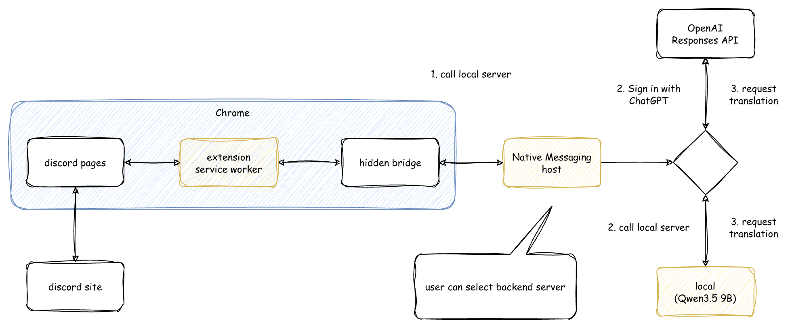

# Discord Translator

Discord Web の受信メッセージを日本語へ、投稿前の日本語の下書きを英語へ翻訳する Chrome 拡張機能です。翻訳先はローカル (MLX-LM / Qwen) と ChatGPT から選べます。

ボットをサーバに追加せず、自分のブラウザで必要な本文だけを翻訳できます。

## アーキテクチャ



## 主な機能

- 受信メッセージの原文を残し、その下に日本語訳を順次表示。
- 日本語の下書きを英語に置き換え、編集・確認してから投稿。「元に戻す」も利用可能。
- 受信メッセージの完成訳を端末内に5日間保存し、再読み込み後も復元。

対象は Chrome で開く `https://discord.com/` です。Discord デスクトップアプリは対象外です。

## 動作環境

| 翻訳先 | 必要な環境 |
| --- | --- |
| 共通 | macOS、Google Chrome、サポート中の Node.js 24 以上の LTS (基準は24) |
| ローカル | macOS 26以降、Apple Silicon、native arm64 の CPython 3.14、モデル保存用のディスク容量 |
| ChatGPT | Sign in with ChatGPT を利用できるアカウント、インターネット接続 |

ローカルでも依存関係とモデルの初回取得にはインターネット接続が必要です。ChatGPT だけを使う場合、Python とモデルの準備は不要です。

## セットアップ

コマンドはリポジトリのルートで実行してください。

### 1. ローカル翻訳を準備する (使う場合のみ)

信頼できる配布元の Python 3.14 を使い、依存関係と固定モデルを取得します。以下は Homebrew で Python を導入した場合の例です。別の配布元なら `--python-source` を実際の取得元に置き換えてください。

```bash
python3.14 -I scripts/setup_local.py --python-source 'Homebrew python@3.14'
./.venv/bin/python -I scripts/model_assets.py fetch
```

使用モデルは `mlx-community/Qwen3.5-9B-MLX-4bit` です。依存関係とモデルはバージョン・ハッシュを固定し、通常起動では取得しません。既存の `.venv` は上書きできません。移行時はサーバを停止して退避してください。詳細は [依存関係とモデルの管理](docs/adr/011-verified-dependency-and-model-inputs.md) を参照してください。

### 2. Chrome 拡張機能と自動起動を登録する (共通)

1. Chrome で `chrome://extensions` を開き、「デベロッパー モード」を ON にします。
2. 「パッケージ化されていない拡張機能を読み込む」で、このリポジトリの `extension/` を選びます。
3. 表示された拡張機能 ID をコピーし、次のコマンドの `<拡張機能 ID>` を置き換えて実行します。

```bash
node scripts/install-native-host.mjs <拡張機能 ID>
```

手動起動中の翻訳サーバがあれば停止し、拡張機能と Discord タブを再読み込みしてください。以後、選択した翻訳先のサーバが自動起動するため、ターミナルを開いておく必要はありません。追加の npm パッケージも不要です。

更新前から使っている場合も、新しい起動方式へ切り替えるために一度だけこの登録を実行してください。

nvm を使う場合、両翻訳先はインストール済みの Node.js 24 以上の LTS から最新版を選んで起動します。npm の更新や、Node.js の更新後に旧版を削除しても再登録は不要です。nvm の default alias を変更する必要もありません。対応する LTS は少なくとも1つ残してください。

リポジトリ、nvm の管理フォルダ、拡張機能 ID が変わった場合は再登録が必要です。nvm 以外では登録時の Node.js を使用するため、その実行パスが変わった場合も再登録してください。

### 3. ChatGPT に接続する (使う場合のみ)

1. 拡張機能のポップアップで、翻訳先を「ChatGPT」にします。
2. `Continue with ChatGPT` を押し、開いた認証画面でログインして利用を許可します。
3. 認証後にポップアップを開き直し、接続済みアカウントを確認します。

API key は不要で、ChatGPT の利用枠を使います。「切断」で端末内のトークンを削除します。接続の失効を確認できなかった場合は、表示される案内に従ってください。

## 使い方

1. Discord Web を開き、拡張機能のポップアップで翻訳先を選んで「Discord Translator を有効にする」を ON にします。Chrome がローカルネットワークへのアクセス許可を求めたら許可してください。
2. **受信メッセージ：**「翻訳」を押すと、原文の下に日本語訳を表示します。失敗時は「再試行」を押します。
3. **投稿前の下書き：** 日本語を入力して「英語に翻訳」を押し、置き換わった英語を確認・編集して投稿します。投稿前なら「元に戻す」で元の下書きに戻せます。自動投稿はしません。

初期状態はローカル・OFF です。翻訳先を変えると OFF になるため、再度 ON にしてください。有効化だけでは新しい翻訳を依頼せず、保存済みの受信訳文を復元します。

OFF にすると翻訳ボタンや訳文を取り除きますが、保存訳と選択先のサーバは維持します。サーバを停止するには、Chrome を完全終了するか拡張機能を無効化してください。ウィンドウを閉じるだけでは停止しない場合があります。

## 通信とデータの扱い

- **ローカル：** 本文を同じ Mac の `127.0.0.1:8080` で処理します。通常起動ではモデル取得や Hugging Face Hub への接続を行いません。
- **ChatGPT：** `127.0.0.1:8766` の補助プログラムを経由し、依頼した本文と翻訳指示を OpenAI へ送信します。API に `store:false` を指定しますが、OpenAI 側の扱いはサービスの条件に従います。
- **端末内の保存：** 設定と受信メッセージの完成訳を保存します。原文や下書き、投稿用の英語訳は永続保存しません。訳文は Chrome の同期領域へ送りません。
- **認証情報：** ChatGPT のトークンは `~/.config/discord-translate/chatgpt.json` に保存します。このファイルを共有・同期しないでください。

## 制約

- 翻訳品質や Markdown・URL・コードの保持は保証できません。重要な内容は原文と照合してください。
- 入力は 8,000 UTF-16 コード単位までです。翻訳は1件ずつ処理し、待機・実行にはそれぞれ120秒の上限があります。
- 下書き翻訳は通常の投稿入力欄のテキストが対象です。メンションなどを含む下書きや、投稿済みメッセージの編集欄は対象外です。
- 手動サーバとの併用や複数 Chrome プロファイルでの同時使用はできません。
- Discord の画面構造が変わると、翻訳ボタンが表示されなくなる場合があります。

## トラブルシューティング

| 症状 | 対処 |
| --- | --- |
| サーバに接続できない／ON にできない | [自動起動の登録](#2-chrome-拡張機能と自動起動を登録する-共通)を確認してください。ローカルネットワークの許可と、ポート8080・8766の競合も確認してください。 |
| `native_host_node_unavailable` | 登録した nvm の管理フォルダに、Node.js 24 以上の LTS が必要です。対応版を導入後、拡張機能を再読み込みしてください。自動取得は行いません。 |
| `local_unavailable` | ローカルの依存関係とモデルを準備済みか確認してください。モデルは `./.venv/bin/python -I scripts/model_assets.py verify` で検証できます。 |
| `venv_already_exists_use_a_new_directory` | サーバを停止し、既存の `.venv` を退避してからセットアップしてください。 |
| `chatgpt_auth_required`／`chatgpt_usage_limit` | ポップアップから再接続するか、「ChatGPT の利用量を管理」で利用枠を確認してください。 |
| 翻訳ボタンが表示されない／翻訳が失敗する | 拡張機能と Discord タブを再読み込みし、OFF → ON を試してください。長文は短くして再試行してください。 |

## 開発と検証

詳しい動作・内部構成は、[要件定義書](docs/current/REQUIREMENTS.md)、[仕様書](docs/current/SPECIFICATIONS.md)、[設計書](docs/current/DESIGN.md)、[設計上の決定 (ADR)](docs/adr/README.md) を参照してください。
